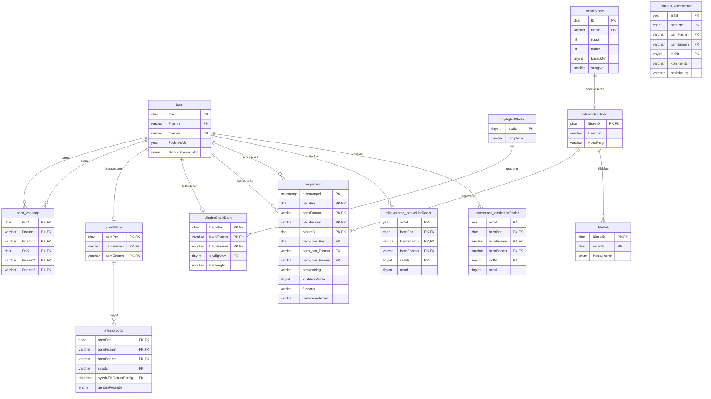

# DTB Konstruktion - SQL

This project is part of an assignment focused on designing and implementing a relational database. The goal is to create a database implementation based on a described domain, in this case "Santas Workshop". Including data related to children, their activities, and interactions with Santa's helpers (Tomtenisse). The database showcases features such as:

- **Tables**
- **Constraints**
- **Triggers**
- **Relationships**
- **Stored Procedures**
- **Virtual tables**
- **Premission handling**

## Purpose

The assignment demonstrates skills in database design, SQL programming, and data management. It showcases the ability to create a normalized schema, with strategic denormalization for preformance, enforce data integrity, and implement advanced SQL features like triggers and constraints.

## Schema

`leveransLogg`, `Barn_status_logg` and `inspelning_insert_logg` are audit tables populated by triggers rather than declared foreign keys, so they're left out of the diagram above for readability.

## How to Use

1. Run the SQL script `Databasimplementation.sql` to set up the database.
2. Explore the schema and test the triggers and constraints by performing operations like inserts, updates, and deletes.

Have fun!
